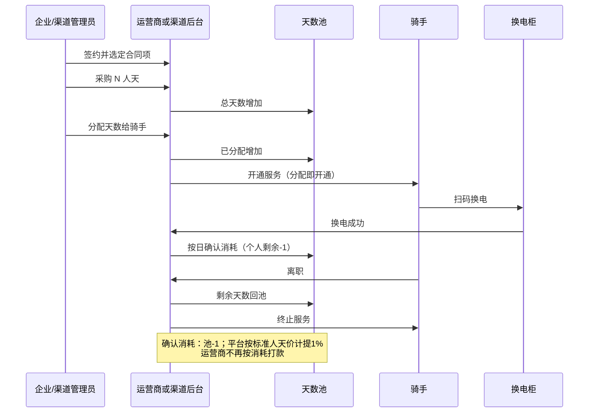

# 人天额度池（天数池）

> **这是什么**：渠道商向**签约运营商**批量买「人天」额度，再分给骑手换电用的库存——属于 **B 端额度**，不是骑手自己买的个人套餐。  
> **谁用**：渠道商后台「人天额度池」；运营商在「渠道销售」看已售池与批发；骑手侧表现为「有人天才能换电」。  
> **依据**：[渠道结算模式规则.md](./渠道结算模式规则.md) · [合作模式与分账.md](./合作模式与分账.md) · [渠道骑手可换电校验.md](./渠道骑手可换电校验.md) · decision-151（按电池型号拆池）· decision-049 / 054 / 060 / 062 / 136 等（详见文末附录）  
> **写法**：[业务文档写作规范](./业务文档写作规范.md)

---

## 业务设定

### 一句话

渠道先付钱买人天进「池」，再把天数分给骑手；骑手换电或当天一直拿着电池，就从池里扣 1 人天。钱在**采购时**已经结给运营商，**不会**因为骑手又换了一次电再给运营商打一笔。平台按「标准人天价 × 1%」在确认消耗时向运营商计提。

### 和「个人包月」有什么不同

| | 个人包月（骑手自购） | 人天额度池（渠道采购） |
|--|----------------------|------------------------|
| 谁付钱 | 骑手 | 渠道 / 企业 |
| 权益从哪来 | 自己买的套餐单 | 池里分配下来的天数 |
| 没用完怎么退 | 按退款规则退给骑手 | 离职未用天数**必须退回池子**；不能退成骑手零钱 |
| 钱什么时候到运营商 | 骑手支付时 | 渠道批发采购时已结清 |

### 池里有什么、谁管（decision-151）

1. **池唯一键 = 渠道 × 运营商 × 电池型号**：同一渠道对同一运营商可有多池（如 60V 一池、72V 一池）；续费/增购加在**对应型号池**，不跨型号合并。  
2. **再签第二家运营商**，按该公司型号再开池。  
3. **可选型号（口径 A）**：运营商设备台账中**有归属记录**的电池型号（含在柜 / 用户持有 / 柜外）即可开批发价、采购、开池；不要求当下在柜可用库存 &gt; 0。  
4. **团队**只做骑手编排，不决定扣哪口池；分配时指定型号池。默认团队开户自动创建，不可改名/停用/删除；其它团队名称本渠道唯一，无在职成员才可停用或删除。  
5. **没有**「团队周期额度上限」；能控的只有：**各型号池还剩多少** + **骑手各型号个人还剩多少**。同时仅一种型号可领电。

### 每天怎么扣人天（首版默认 · decision-126 / 151）

主路径：**个人剩余闸门（按型号）+ 按日确认消耗**（取消整批预占）。与「按自然日服务、分配即开通」配套。

1. **分配**：从**指定型号池**可用划到骑手该型号个人剩余；未分配 = 该型号剩余 0，不可领该型号电。  
2. **闸门**：在职且**当前可领电型号**个人剩余 ≥ 1，且取出电池型号匹配 → 可换电；否则不可换（持电仅可还）。  
3. **逾期占用**：该型号个人剩余 = 0 仍持电时，按日从**对应型号渠道池可用**扣人天（不足一天按 1），不向骑手收现金；见运营商「逾期管理」（decision-136）。  
4. **确认消耗**（每日最多 1 人天，记入对应型号池）：  
   - 当天有成功换电 → 扣 1；  
   - 没换电但**日终仍拿着电池** → 也扣 1；  
   - 没换电且**没拿电池** → **不扣**。  
5. **不做** 0 点整批预占。续费预警按**单池**：可用 &lt; 持有该型号额度的在职人数 × 10（decision-113 系数保留，分母按型号口径）。

### 分配与开通（首版）

- 管理员把某型号天数分给骑手后，**立刻开通**该型号服务（从分配日起算）。  
- （二期可选）也可做成「第一次换电才开通」；首版以分配即开通为主。

### 更换电池型号（强制迁移 · decision-151）

顺序不可跳：

1. **收回**原型号人天额度（未用天数回原型号池）；  
2. **归还**手中电池（未还电不可发新型号额度）；  
3. **分配**新型号人天额度；  
4. **重新领取**新型号电池。  

迁移未完成：禁止领新型号电；不可静默改绑型号。

### 骑手离职 / 解绑

硬性规则：

1. 立刻停掉他靠人天池开通的服务（**不向骑手退款**）。  
2. 算出还能退回的天数，加回**原型号池**可用。  
3. 留下回池记录（原因如：离职）。

### 额度不够时

- 当前可领电型号个人剩余为 0 → 不能换电；若手里还有电池 → **「待还电」**，只能还电（原因：**个人无额度** / 可注明型号）。  
- **没有**自费应急兜底。  
- 出路：渠道再分配同型号 / 续费该型号池后再分配；换型号走上方四步。

### 池状态「余额不足」（唯一口径 · 按池）

池状态、顶栏红字、短信预警按**每个型号池**计算（decision-113 系数 + decision-151）：

**该池可用余额 < 持有该型号额度的在职骑手数 × 10**

- 在职且持有该型号额度（含剩余 0、待还电）计入；离职不计。  
- 刚好等于 10 天 → 仍为「使用中」。  
- 该型号在职为 0 → 该池不为余额不足。  
- **已作废**「可用 / 总量 < 20%」与「一渠道一池」表述。

### 钱与平台费

| 时点 | 运营商 | 平台 | 池 |
|------|--------|------|-----|
| 渠道采购到账 | 已收到该型号批发款 | — | 对应型号池总天数增加 |
| 骑手确认消耗 | **不再**按消耗另收款 | 按**全网统一**标准人天价 × 1% 计提（**不分型号**） | 对应型号池消耗 +1 |

线下对公与保证金同一套认款包（decision-114）：**附言填采购单号**；**不填转账日**（decision-115）。

- **平台标准人天价**：全网一个日值，**不按电池型号区分**（decision-151）。  
- **运营商批发价**：按 **渠道(含默认行) × 电池型号** 在「平台设置 → 人天批发价」维护；下单锁定型号与单价。  
- **池不能在线退款**：线下谈妥后由运营商对**具体型号池**调账。

### 池过期怎么处理（合同可选）

签约时可约定过期策略，例如：

- 过期不退；或  
- 仅整池未分配部分可申请退企业；或  
- 部分过期也可按未消耗天数核算退（需审核）。

首版演示以业务操作为主；具体选项见附录。

### 后台落在哪

**客户 · 人天额度池**（顶层 Tab，已去掉「额度使用规则」）：

| 入口 | 做什么 |
|------|--------|
| 额度池 | 池列表（含**电池型号**、可用/已分配/消耗、续费）+ 额度明细账本 |
| 骑手登记 | 登记骑手、编入团队；展示各型号剩余；非默认团队可增改停删（无在职成员才可停/删） |
| 额度分配 | 选**型号池**给人配天数 / 收回；换型号走收回→还电→再分配；看分配与收回明细 |
| 消耗明细 | 每日谁消耗了、换了几次、是否持电池 |
| 零售价 | （二期相关）城市/站点组合价等演示 |
| 异常记录 | 余额不足整批失败、待人工等；可手动或续费后自动重试 |

**运营商**：渠道销售里看已售额度池、批发与调账；总览可有低余额提醒。  
**关联**：用户列表可看人天权益状态；流水里采购入账等类型。

### 常见问题（白话）

| 问 | 答 |
|----|-----|
| 一个渠道要几个池？ | 对每个签约运营商，按**电池型号**各一池（decision-151）；同运营商可有 60V、72V 等多个池。 |
| 消耗后运营商还要再收款吗？ | 不要，批发时已收齐。 |
| 没换电但拿着电池扣不扣？ | 扣 1 人天。 |
| 没换电也没电池？ | 不扣。 |
| 额度没了还拿着电池？ | 待还电，只能还不能换；渠道续配。 |
| 池状态什么时候是「余额不足」？ | 可用 < 在职人数 × 10 天；与顶栏、短信同一条。 |
| 能否在线把池款退掉？ | 不能，须线下协商后再调额度。 |
| 渠道骑手能跨网换电吗？ | 能，规则与个人用户类似；归属仍是额度售卖方运营商。 |
| 默认团队能删或改名吗？ | 不能。开户自动创建，始终启用。 |
| 团队名能重复吗？ | 同一渠道内不能。 |
| 有在职骑手时能停用/删除吗？ | 不能，须先变更或移除。 |

### 推荐配置（首版场景）

站点包干、骑手几乎天天换电：**自然日服务 + 个人余额确认消耗 + 分配即开通 + 允许部分过期退（若合同需要）**（decision-126）。

---

## 实现附录（开发用）

> 业务读者可跳过。实体名、枚举码、时序图、历史修订集中于此。

### A. 合同可配置项（枚举）

| 配置 | 取值 | 含义 |
|------|------|------|
| 扣天口径 | 自然日 / 有换电才扣 | 首版演示以自然日 + 预占确认为主 |
| 计费批处理 | 按日确认消耗 | 首版：换电或日终持电确认；未用不扣（decision-126） |
| 激活时机 | 分配即开通 / 首换开通 | 首版以分配即开通为主 |
| 池过期退款 | 不退 / 仅整池未分配可退 / 部分过期可退 | 签约选定 |
| 结算节奏 | 按骑手 / 企业月结 | **二期**；仅内部对账，非向运营商二次打款 |

### B. 硬性：离职回池（计算口径）

- 自然日：剩余自然日回池（冻结顺延段不计剩余）。  
- 有换电才扣：分配天数 − 已扣累计。  
- 首换开通且从未换电：全部分配天数回池。  
- 写回池流水；终止由池产生的套餐单；不向骑手退款。

### C. 核心实体（名称对照）

额度池、采购单、分配单、日扣天流水、回池流水、（二期）结算批次；骑手表单由池分配激活，来源标记为人天池。团队须绑定消耗池 ID。

### D. 主流程（时序）

### E. 确认消耗判定

| 当日 | 是否确认 1 人天 |
|------|----------------|
| ≥1 次成功换电 | 是 |
| 无换电但持有电池 | 是 |
| 无换电且未持电池 | 否（不扣） |

额度不可用仍持电池：状态「待还电」；原因 **个人无额度**（decision-126 废止主路径「预占失败」）；仅可还电。

**逾期占用（decision-136）**：这段持电期间，按日从**该渠道 × 本运营商额度池可用**扣 1 人天（不足一天按 1）；触发动作「逾期占用」。不向骑手收现金。当日若已按「日终持电」确认消耗，当天不再记逾期占用。池可用可扣成负数（欠人天）。运营商「订单与服务 → 逾期管理」可查名单。部分覆盖 decision-049「无预占则不扣池」。

### F. 换电前校验

须做权益校验：无人天则不可换电；持电池可还电；**不返回**自费兜底 SKU。详见 [渠道骑手可换电校验.md](./渠道骑手可换电校验.md)。

### G. 决策与差异索引

- decision-049：额度耗尽仍持电池 → 待还电  
- decision-054：取消渠道 C 端自费兜底  
- decision-060：持电池确认消耗与平台提成场景  
- decision-062：取消额度使用规则 / 团队周期上限  
- decision-113：余额不足 = 可用 &lt; 在职×10（作废 20%）  
- decision-114：线下采购对公认款包（附言=单号，流水号作证据）  
- decision-115：人天采购不填转账日  
- decision-116：非默认团队可增改停删；无在职成员才可停用或删除  
- decision-136：剩余 0 仍持电 → 从渠道额度池扣「逾期占用」人天（覆盖 049 不扣池）  
- decision-142：骑手端展示已扣人天与「无需支付占用费」；个人占用费暂不封顶  
- decision-143：个人占用费须先付清才能还电；运营商可减免；全额进资金实收、不分润  
- 外部 PRD 差异追踪（非摘要源）：[额度池PRD差异清单.md](./额度池PRD差异清单.md)

### H. 修订记录（摘要）

| 版本要点 | 说明 |
|----------|------|
| 初版 | 合同四项 + 离职强制回池 |
| 后续 | 预占确认、一运营商一池、B2B 采购结清、取消团队规则层与自费兜底等 |
| 2026-08-25 | 余额不足统一为在职×10；作废 20%（decision-113） |
| 2026-08-25 | 线下采购对公认款包：附言=单号，流水号作证据（decision-114） |
| 2026-08-25 | 人天采购去掉转账日（decision-115） |
| 2026-08-25 | 人天池团队：非默认可增改停删（decision-116） |
| 2026-09-15 | 剩余 0 仍持电：从渠道额度池扣逾期占用人天（decision-136） |
| 2026-09-15 | 骑手端展示无需付占用费；个人还电一次结清、暂不封顶（decision-142） |
| 2026-09-15 | 个人占用费先付后还、减免日志、不分润入账（decision-143） |
